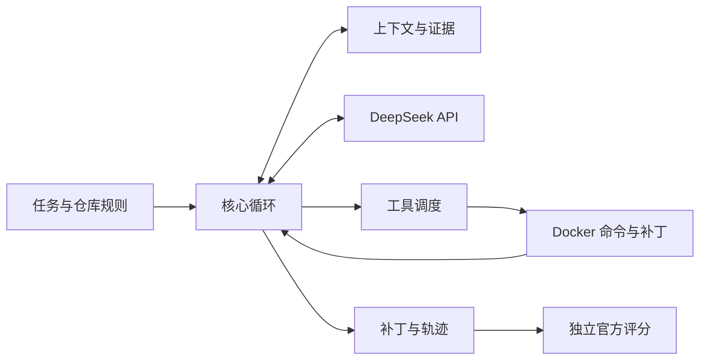

# Coding Harness

一个独立实现的最小 coding agent：用 DeepSeek 读代码、应用补丁、运行测试，并导出可独立验收的结果。核心循环、上下文管理和工具调度自行实现；SDK、Docker 和补丁解析复用现成组件。

**已验证结果：SWE-bench Lite 固定原顺序前 30 题，20/30（66.7%）；同题裸模型 9/30（30.0%）。** 两组预算不同，这不是等算力对比，也不是完整 300 题成绩。[逐题结果与限制](docs/evaluation-results.md)

## 配置 API Key

需要 Git、Python 3.11+、能运行 Linux 容器的 Docker。Windows 还需要 WSL2，并开启 Docker Desktop 对该发行版的集成；评测在 Linux/WSL 内运行。

```sh
git clone https://github.com/piaoyun2022/coding-harness.git
cd coding-harness
```

将**仓库根目录**的 `.env.example` 复制为 `.env`，在 `.env` 中填写：

```dotenv
DEEPSEEK_API_KEY=你的DeepSeek密钥
```

Linux/WSL 用 `cp .env.example .env`；Windows PowerShell 用 `Copy-Item .env.example .env`。`.env` 已被 Git 忽略，密钥不进入代码容器。模型调用会产生 DeepSeek API 费用。

## 一键评测

填好密钥并启动 Docker 后，在仓库根目录执行：

**Linux / WSL**

```sh
bash scripts/evaluate.sh
```

**Windows PowerShell**

```powershell
powershell -ExecutionPolicy Bypass -File scripts/evaluate.ps1
```

入口会准备独立 Python 环境和固定版本题集，依次完成**裸模型与 Agent 生成补丁 → 官方测试 → 汇总报告**。不需要 Codex、子智能体或手动整理评分文件。

默认跑原顺序 **30 题、2 路任务**；Agent 每题最多 300 轮、500 万累计 token、15 分钟。环境构建和官方评分时间另计。结果写入新的 `artifacts/` 运行目录，不覆盖历史成绩。首次运行需要下载依赖和容器镜像。

```sh
# 只检查环境，不发模型请求
bash scripts/evaluate.sh --preflight
# 只跑 Agent，或选择全量 300 题
bash scripts/evaluate.sh --mode agent --limit 30 --workers 2
bash scripts/evaluate.sh --mode both --limit 300 --workers 2
```

完整参数、Windows 发行版选择、产物格式、资源与失败处理见 [评测操作指南](docs/evaluation.md)。**新入口未重新跑出上述 20/30**；该成绩来自同一 C 版核心的已完成实验，公开入口已通过安装预检与已有补丁的真实评分重放，详见[验证记录](docs/release-validation.md)。

## 用 Agent 修自己的仓库

```sh
python -m venv .venv
# Linux / WSL：source .venv/bin/activate
# Windows：.venv\Scripts\Activate.ps1
python -m pip install -e .
python -m coding_harness run --repo /path/to/repo --task "修复这个问题并运行相关测试" --output artifacts/my-task
```

输入仓库保持不变；补丁、工具轨迹、历史证据和运行结果保存在输出目录。模型声明完成不代表修复正确。

## 架构与报告



- [面试官版 PDF（2 页）](docs/interview-report.pdf) · [简洁文字版](docs/interview-report.md)
- [项目总报告：架构、组件、实现与实验](docs/project-report.md)
- [可复核的评测结果](docs/evaluation-results.md) · [一键评测指南](docs/evaluation.md)
- [代码与文档对应关系](docs/code-map.json) · [开发约定](AGENTS.md)
- [第三方依赖说明](THIRD_PARTY_NOTICES.md)

当前发布的是「先交接摘要、再清理历史，并增加收尾提示」的 C 版。它仍可能因工具事实累积或摘要校验而停止；后续容量修复实验不包含在该成绩或默认实现中。每次代码改动必须同步更新 `docs/`，CI 检查文档映射和离线测试。
