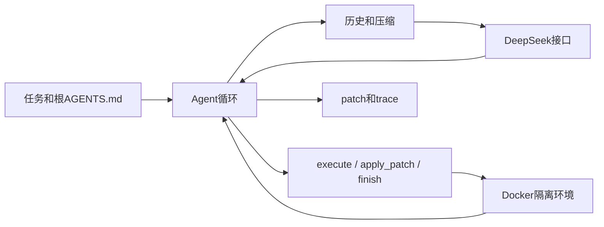

# 最小 Coding Harness 架构

目标是在48小时面试作业范围内，交付可解释、可运行、可评测的单agent。自行编写决策循环、上下文管理与工具调度，复用SDK、补丁解析库和容器基础设施。课程作业只作为参考；这不是课程提交物，也不是Codex完整复刻。

## 五个职责
1. Provider发送结构化tools并保留tool_calls与reasoning_content，不执行代码。
2. Context保存不可变任务/规则、摘要与最近完整回合；只在完整回合边界压缩，失败不丢原历史。
3. Agent控制调用、预算、工具结果配对、结束；finish是模型声明，不是正确性判定。
4. Tools校验工具名与JSON参数，调度到环境；坏参数返回错误，模型可下一轮纠正。
5. Environment执行终端/补丁并导出差异。默认Docker，没有宿主目录或Docker socket挂载；Local仅可信测试显式使用，Modal可选。

CLI拥有工作区快照、资源创建与清理；Trace是横切记录。benchmark在外部提供任务并用官方测试验收补丁，不参与agent决策。

## 数据流与不变量
每轮先检查预算和上下文，再请求模型。只处理未截断且结构有效的回答；整批tool_calls都有对应observation。一次写操作即便失败也不自动重试；模型可据错误明确提出新动作。保存完整回合后再继续或结束。导出patch不改输入仓库。

兼容范围为根AGENTS.md、Codex风格apply_patch格式与可审查Git差异；不宣称能直接复用Codex会话存储或通用记忆接口。首版不包含Skills、MCP、长期记忆、撤销、多agent和断点恢复。

## 评测边界
固定SWE-bench Lite300题版本。裸模型基线只获取基于issue的确定性检索上下文，一次生成补丁，无工具、测试反馈或gold定位。Agent可自主探索。主分数为官方完整解决率，辅助测试比例另列；缺失、基础设施问题不能从分母悄悄删除。
