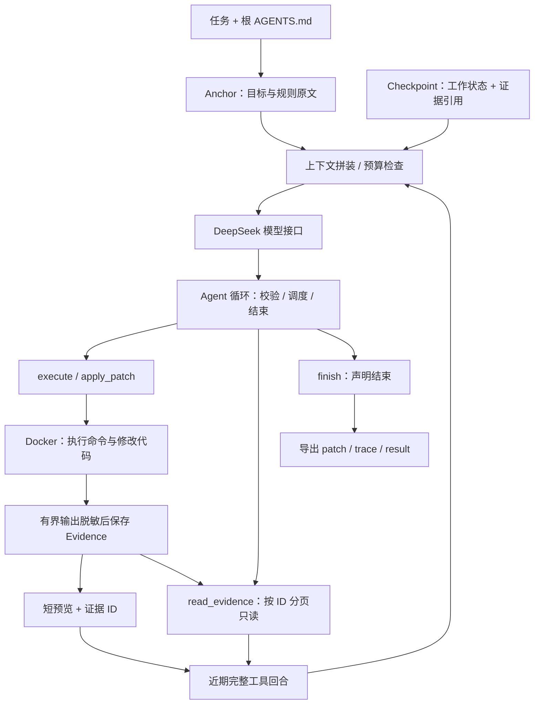

# 最小 Coding Harness 架构

目标是在 48 小时面试作业范围内，交付可解释、可运行、可评测的单 agent。自行编写循环、上下文管理和工具调度，复用模型 SDK、补丁解析库和容器。课程作业只作为参考，不是课程提交物。

## 五个组件

| 组件 | 职责 | 主要实现 |
|---|---|---|
| Provider | 发送工具 schema，保留返回的 tool_calls、推理内容和用量 | OpenAI SDK 调 DeepSeek；不使用 Agent Runner |
| Context | 拼装四层上下文、估算预算、清理旧预览、校验并替换 Checkpoint | 自写逻辑 + Pydantic |
| Agent | 串联模型和工具，管理轮数/时间/token，保证调用结果配对 | 自写循环 |
| Tools | 校验四个工具的名称、参数，执行或返回明确错误 | Pydantic；补丁解析复用 agents.apply_diff |
| Environment | 在隔离副本里执行命令/补丁，限制输出并导出差异 | 默认本地 Docker；Local 仅显式可信测试；Modal 可选 |

CLI 管理副本和资源生命周期；Trace 与 Evidence 保存本次运行记录。评测器在 Agent 外部提供任务和验收补丁。

## 四层上下文与压缩顺序

| 层 | 内容 | 压缩时如何处理 |
|---|---|---|
| Anchor | 系统规则、原任务、根 AGENTS.md | 保留原文，不让摘要改写 |
| Checkpoint | 模型整理的当前状态、后续计划、证据引用；程序记录的工具事实 | 结合旧 Checkpoint 与更早完整回合重新生成，校验后替换 |
| Recent tail | 最近完整的模型请求和对应工具结果 | 按 token 预算保留，至少最新一轮，调用与结果不可拆开 |
| Evidence | 命令/补丁参数与原始有界结果 | 宿主端脱敏保存，模型凭 ID 和字符范围回读 |

每轮输入计入工具说明、固定消息、状态与历史，另为输出和安全余量预留空间。当前 token 数是 UTF-8 长度启发式估算，并非 DeepSeek 的精确 tokenizer。

超过预算时，先把旧工具预览换成可回读的引用；还不够，再生成结构化 Checkpoint。只有格式、证据引用、体积与输入预算校验通过，才替换旧状态；否则受控停止。最新完整回合或 Anchor 自身过大时也停止，不静默删除约束。

Checkpoint 中的模型描述仍可能出错。程序只能核验证据存在且完整、引用范围和原始 exit_code/timeout 等事实，不能把摘要中的“修复成功”自动认证为真实测试通过。日志保存也有上限：捕获或存储发生截断会明确标记，不承诺无限量原文保留。

## 一次运行的不变量

- 每一批 tool_calls 都有对应 observation，压缩只在完整回合之间发生。
- 工具写操作即使返回失败，也不自动重试；证据保存失败后停止，不重放已尝试动作。
- read_evidence 只查询本次运行已登记的 ID，不接受任意宿主路径。
- 任务代码不接收模型密钥、评分测试、标准答案或 Docker socket；输入仓库保持不变。
- finish 只是模型声明完成，正确性仍由测试和外部验收确认。

兼容范围为根 AGENTS.md、Codex 风格 apply_patch 格式与 Git 差异。不增加 Skills、MCP、长期记忆、撤销、多 agent 或会话恢复。Checkpoint 是上下文里的工作状态，不是进程断点。

## 评测边界

固定 SWE-bench Lite 300 题版本。裸模型仅获得基于 issue 的确定性检索上下文，一次生成补丁，无工具、测试反馈或标准答案定位；Agent 才能自主探索。完整解决率按官方验证器记录，基础设施失败单列，分母不悄悄缩小。

当前对比实验按用户要求取原始题目顺序的前三十题。裸模型使用此前提交冻结的源码和参数，不受这次上下文改造影响；Agent 使用验收后的新版本。两者模型与推理档一致，多轮预算另行记录。生成补丁和通过官方验收是两个阶段，分别报告进度。

课程分层来源：[Lecture 03，第 48–51 页](https://www.cmu-agents.com/slides/lecture-03-long-context.pdf#page=48)。接口细节见 [Context](modules/context.md)、[Agent](modules/agent.md)、[Evidence](modules/evidence.md)；验证范围见各模块测试文档。
