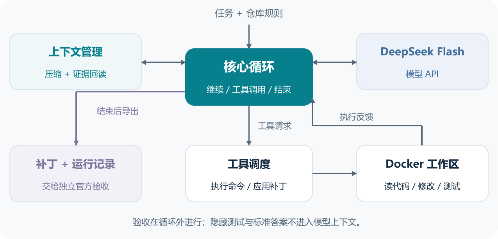
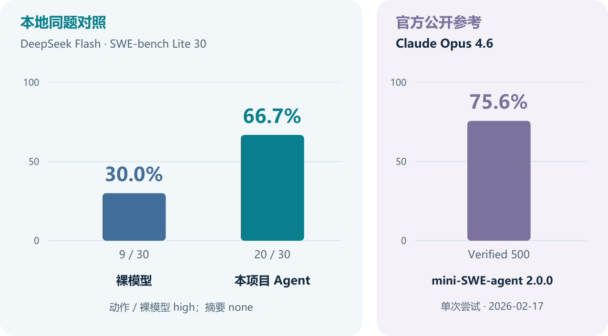

# 最小 Coding Agent：面试项目报告

[两页 PDF](interview-report.pdf) · [详细技术报告](project-report.md)

## 目标与上层架构

实现一个能接收任务和仓库、自主读代码、修改、运行测试并交付补丁的最小 Agent。核心循环、上下文管理与工具调度自行实现；模型 SDK、补丁库和 Docker 复用现成组件。不引入多 Agent、长期记忆或 MCP。

模型接口请求 DeepSeek Flash；上下文管理保留任务和工作状态；核心循环协调模型与工具；工具层校验命令、补丁和证据回读；Docker 提供独立工作区。官方验收位于循环外，隐藏测试与标准答案不进入模型上下文。

## 上下文压缩

上下文分四层：**Anchor** 固定任务与规则；**Checkpoint** 记录定位、修改、验证状态和下一步；**近期完整回合** 保留调用与全部对应结果；**外置 Evidence** 有界保存原始输出，按 ID 分页回读，截断如实标记。

接近输入预算时，先从未清理的早期历史生成候选摘要。程序检查格式、证据引用、真实工具状态与最终体积，通过后才一次性替换；失败保留旧历史并受控停止，不重放写操作。引用有效不保证摘要语义全部正确。C 版工具事实仍会累积，长任务可能在累计 token 尚有余额时耗尽上下文；后续容量修复未纳入本版成绩。

## 主工作流

独立工作区初始化后，循环执行“整理上下文 → 请求模型 → 校验并执行工具 → 保存观察”。定位问题、应用补丁、运行相关测试、检查差异后调用 finish；只围绕未解决问题继续。工具调用与结果严格配对，不执行截断的模型请求。输入仓库不变，模型密钥留在宿主端。

不要求全仓测试全部通过，但需如实说明剩余异常与未运行测试。finish 是完成声明；结束后导出补丁和记录，正确性由官方验证器独立判断。

## 实测结果与边界

| 本地系统 | 解决数 | 解决率 | 累计 token |
|---|---:|---:|---:|
| 裸 DeepSeek Flash：固定检索、单次生成 | 9/30 | 30.0% | 约 1.14M |
| 本项目 C 版 Agent：多轮工具反馈 | 20/30 | 66.7% | 约 12.49M |

Agent 多解决 **11 题，提高约 36.7 个百分点**。动作及裸模型使用 high，摘要使用 none。Agent 每题上限为 300 动作轮、5M 累计 token、900 秒循环时间；裸模型无工具或测试反馈。预算与实际消耗不等，不能将提升单独归因于压缩、工具或某条提示。

30 题按任务 ID 升序取自 SWE-bench Lite，含 6 道 Astropy、24 道 Django；这是已用于开发的固定子集，不是随机、未见样本或完整 300 题成绩。失败与空补丁仍计入分母。C 版有 11 题因压缩失败停止，其中 6 题为空补丁；容量或校验都可能造成停止，不能一概归为模型能力不足。[逐题记录与设置](evaluation-results.md)

右侧 **75.6%** 来自 SWE-bench 官方记录：**Claude Opus 4.6 + mini-SWE-agent 2.0.0**，Verified 500 题，单次尝试，2026-02-17；推理 effort 未注明。模型、题集与设置不同，只作外部参考，**不能跨区排名**，也不是本仓库重跑成绩。[固定版本官方来源](https://github.com/SWE-bench/experiments/blob/40f164d5b8f1d249bf95a6df8b74b577fd8e519d/evaluation/verified/20260217_mini-v2.0.0_claude-4-6-opus/metadata.yaml)

**下一步：**将工具事实纳入有界压缩，再以固定版本、同题同预算验证长任务稳定性与修复效果。
