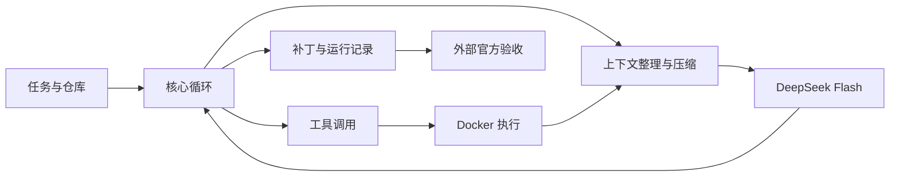

# 最小 Coding Agent：面试项目报告

## 目标与上层架构

实现一个能接收代码仓库和修改任务、自主读代码、修改文件、运行测试并交付补丁的最小 Agent。核心循环、上下文管理和工具调度自行实现，模型 SDK、补丁处理库与 Docker 复用现成组件。

核心包含五部分：模型接口负责请求 DeepSeek Flash；上下文管理保留任务与工作状态；循环决定继续、执行或结束；工具提供命令执行、补丁编辑和证据回读；Docker 提供独立执行环境。评测位于 Agent 外部，避免把隐藏验收信息交给模型。不加入多 Agent、长期记忆或 MCP，以控制复杂度。

## 上下文压缩：保留可继续工作的状态

上下文分四层：**Anchor** 固定原始任务与规则；**Checkpoint** 记录当前定位、已做修改、验证状态和下一步；**近期回合** 保留完整的模型调用与对应工具结果；**外置证据** 保存有界原始输出，模型可按 ID 分页回读。

输入估算超过预算时，从旧 Checkpoint 和未清理的早期回合生成结构化摘要。程序验证格式、证据引用、原始工具状态与最终输入体积，通过后才一次性替换历史；失败则保留原历史并受控停止。最新完整回合不拆开，摘要不能改写任务或把失败退出码改成成功。

引用有效不代表摘要语义一定正确，捕获时已截断的输出也无法恢复。当前 C 版还有明确限制：历史工具事实仍会累积，长任务可能在步数或累计 token 尚有余额时耗尽上下文。外置日志减少了长输出占用，但没有完全解决状态增长问题。

## 主工作流与关键约束

先创建输入仓库的独立副本并读取根目录规则。随后反复执行“整理上下文 → 请求模型 → 校验工具参数 → 执行 → 保存证据与观察”，直到模型声明完成或预算触发停止。

修改采用专用补丁工具，测试失败会作为下一轮反馈。工具调用与结果严格配对；不执行被截断的模型请求，也不自动重放已尝试的写操作。Docker 默认禁网，模型密钥留在宿主端。结束后导出补丁和运行记录，输入仓库保持不变。

收尾要求检查目标行为、相关测试和最终差异；不要求全仓测试全部通过，但必须说明未运行测试和剩余异常。模型声明完成与实际修复成功分开，后者由独立官方验证器判断。

## 实测结果与结论边界

两组使用相同 DeepSeek Flash 和固定的 30 道开发题，均由 SWE-bench 官方验证器验收。

| 系统 | 解决数 | 解决率 | 累计 token |
|---|---:|---:|---:|
| 裸模型：固定检索、单次生成 | 9/30 | 30.0% | 约 1.14M |
| C 版 Agent：多轮工具反馈 | 20/30 | 66.7% | 约 12.49M |

Agent 多解决 **11 题，提高约 36.7 个百分点**。裸模型获得确定性检索的代码上下文，没有工具或测试反馈；Agent 可以持续探索与修正。因此这是不同运行方式的系统对照，预算和实际消耗不等，不能把提升单独归因于压缩、工具或某条提示。

子集按任务 ID 排序取前 30 题，包含 6 道 Astropy、24 道 Django，开发中已查看过这些案例；不是随机样本、未见测试集或完整 300 题榜单成绩。空补丁和失败仍计入分母，不从多次尝试中挑选最好结果。逐题数据与设置见[完整评测记录](evaluation-results.md)。

**下一步：**将工具事实也纳入有界压缩，并在固定版本、同题同预算下验证长任务稳定性与修复效果。
