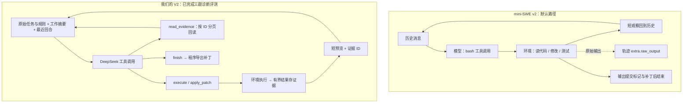

# mini-SWE-agent 与我们的最小 coding harness

查证日期：**2026-10-14**。mini-SWE 固定到官方提交 [`04d809c…`](https://github.com/SWE-agent/mini-swe-agent/blob/04d809ceab9df28f9adaed044884180159172930/src/minisweagent/__init__.py#L11)，源码版本 **2.4.6**，提交日期 2026-09-03。比较对象是其默认 `DefaultAgent + LitellmModel + SWE-bench 配置`，不把其他后端或自定义扩展混为默认行为。

我们的已提交基线是 **`6c6e499fcbcaf3c283767acf0a2363a6a50a0670`**。下文 **V2** 指本轮上下文改造：已通过本地集成回归、真实 Docker 输出捕获验证及六次连续真实模型摘要验证，已记录在本地提交 `05359ae`。摘要验证使用受控动作与替身环境；同题前三题实测现已完成，结果见末节；这不是完整 SWE-bench 成绩，不能据此声称上下文改造提升了代码能力。详细证据见 [集成验证](testing-core.md)。

## 先看这三点

1. **两个 agent 的主线相同：问模型 → 执行工具 → 把结果带回下一轮。** mini-SWE v2 默认也使用原生 tool calling；区别是它只提供 `bash`，我们提供 `execute / apply_patch / finish`，V2 再加 `read_evidence`。[模型调用源码](https://github.com/SWE-agent/mini-swe-agent/blob/04d809ceab9df28f9adaed044884180159172930/src/minisweagent/models/litellm_model.py#L64-L105)、[我们的工具](C:/Users/Vicco/Desktop/Aworkshop/cmu/2026Fall/NG/coding-harness/src/coding_harness/tools.py:35)。
2. **最大的设计差别在历史管理。** mini 默认一直追加消息，SWE 配置只缩短单次命令观察。我们基线已经有“早期摘要 + 最近完整回合”；V2 进一步保留原始任务、结构化工作摘要与可回读证据。这能处理较长任务，也增加了验证、预算和失败处理的代码。[mini 循环](https://github.com/SWE-agent/mini-swe-agent/blob/04d809ceab9df28f9adaed044884180159172930/src/minisweagent/agents/default.py#L69-L157)、[观察模板](https://github.com/SWE-agent/mini-swe-agent/blob/04d809ceab9df28f9adaed044884180159172930/src/minisweagent/config/benchmarks/swebench.yaml#L130-L158)、[我们的 Context](C:/Users/Vicco/Desktop/Aworkshop/cmu/2026Fall/NG/coding-harness/src/coding_harness/context.py:81)。
3. **mini 把更多工作交给模型使用 shell；我们把编辑与执行约束做成明确组件。** 专用补丁工具让修改格式更可控，但需要补丁处理、路径校验和沙箱工具依赖；并非组件越多就越会修代码。[mini 工具定义](https://github.com/SWE-agent/mini-swe-agent/blob/04d809ceab9df28f9adaed044884180159172930/src/minisweagent/models/utils/actions_toolcall.py#L11-L27)、[我们的补丁实现](C:/Users/Vicco/Desktop/Aworkshop/cmu/2026Fall/NG/coding-harness/src/coding_harness/patching.py:107)。

## 一轮任务怎么走

两边都用新 shell 执行每次命令；文件修改会保留，`cd`、临时环境变量等 shell 状态不会自动保留。图中的结束只代表提交修复，是否正确由独立评分确认。

## 组件对照

| 组件 | mini-SWE 2.4.6 默认路径 | 我们的实现 |
|---|---|---|
| 核心循环 | `step = query + execute_actions`；模型适配器负责把回复解析成 actions、把结果转成观察 | 自写 Agent 调用 Context、模型和工具调度；完整配对 tool-call ID，写操作不自动重放。见 [Agent](C:/Users/Vicco/Desktop/Aworkshop/cmu/2026Fall/NG/coding-harness/src/coding_harness/agent.py:32) |
| 模型接口 | 默认 LiteLLM 原生 `bash` tool call；另有文本代码块解析适配器可选，不应把 v1 方式当成 v2 默认 | OpenAI Python SDK 调 DeepSeek；保存 `reasoning_content` 与工具调用。只复用传输 SDK，不使用 Agent Runner。见 [Provider](C:/Users/Vicco/Desktop/Aworkshop/cmu/2026Fall/NG/coding-harness/src/coding_harness/provider.py:11) |
| 改代码 | 用 `bash` 调 shell、Python 或环境已有编辑工具；默认工具表没有专用 `apply_patch` | `apply_patch` 支持新增、更新、移动、删除；复用 `agents.apply_diff`，包装路径检查和失败处理。`execute` 仍能写文件，专用编辑工具本身不是隔离边界 |
| 历史与压缩 | 默认循环无自动摘要步骤；SWE 配置把大观察缩为头尾各 5000 字符。上下文超窗被列为不重试的模型错误 | **基线：**普通文本摘要 + 最近完整回合。**V2：**固定原始任务/规则，先移除可回读旧预览，再生成结构化工作摘要；程序填回工具事实，坏摘要不替换旧历史 |
| 执行环境 | Local 在主机执行并继承宿主环境；Docker 使用已有镜像，仅按配置注入环境变量。Docker 默认 `run_args=[--rm]`，网络/资源策略可由配置补充 | Docker 默认禁网、CPU/内存/PID 限制、无宿主目录挂载；Local 必须显式允许；Modal 可选。worker 保留超时进程树清理。见 [Environment](C:/Users/Vicco/Desktop/Aworkshop/cmu/2026Fall/NG/coding-harness/src/coding_harness/environment.py:180) |
| 终止与预算 | 命令成功且首行出现提交标记才结束；支持步数、美元成本、墙钟时间及连续格式错误上限。成本在调用后累计 | `finish` 必须独占一轮；限制步数、时间、累计 token、命令时长。V2 给输入、输出和余量分别留预算。见 [Settings](C:/Users/Vicco/Desktop/Aworkshop/cmu/2026Fall/NG/coding-harness/src/coding_harness/config.py:8) |
| 轨迹与证据 | JSON 轨迹含模型原回复、成本及 `extra.raw_output`；请求模型前去掉 `extra`。不是“截断后原日志就没了” | 基线有脱敏 JSONL trace；**V2** 增加独立 EvidenceStore，模型按 ID 分页读取。每流默认捕获 1 MiB，超限明确标记，不宣称完整保存。见 [Trace](C:/Users/Vicco/Desktop/Aworkshop/cmu/2026Fall/NG/coding-harness/src/coding_harness/trace.py:8)、[Evidence](C:/Users/Vicco/Desktop/Aworkshop/cmu/2026Fall/NG/coding-harness/src/coding_harness/evidence.py:18)、[Worker](C:/Users/Vicco/Desktop/Aworkshop/cmu/2026Fall/NG/coding-harness/src/coding_harness/worker.py:94) |
| 评测边界 | 批处理读取题目、创建环境、产出 `preds.json`；官方评分另跑 | Agent 导出补丁；裸模型基线为另一条单次生成路径；官方评分另跑，并核对报告与补丁的绑定。见 [评测入口](C:/Users/Vicco/Desktop/Aworkshop/cmu/2026Fall/NG/coding-harness/src/coding_harness/benchmark.py:455) |
| 依赖与部署 | 标准包还有 LiteLLM、Pydantic、Jinja2、Tenacity、Typer、Textual、datasets 等；默认 Docker 直接调用镜像已有 shell，不需在镜像中安装 mini 的 Python 包 | 核心直接依赖 openai、pydantic、python-dotenv、openai-agents；入口用 argparse。容器需额外 Python 与补丁 SDK，因此首次准备更重 |

**两处容易混淆：**mini 的“约 100 行”描述核心 agent，不是整个项目；本次固定版本的 `agents/default.py` 实际为 190 物理行，模型、环境、配置和评测脚本另计。其首页仍有“不用 tool calling”的旧描述，本篇以固定源码和 [v2 迁移说明](https://mini-swe-agent.com/latest/advanced/v2_migration/#tool-calling)为准。

## 我们可以借鉴什么

- **保持循环一眼可读。** 模型调用、工具执行、历史更新各有明确入口，评测调度继续放在外部；不为了“最小”把所有职责塞进一个函数。
- **改善模型犯小错后的反馈。** mini 区分缺少工具调用、参数格式错误、输出被截断，并设置连续错误上限。我们可以借鉴这套提示与计数，仍保留“写工具不自动重放”的约定。
- **保留当前有目的的差异。** 专用补丁和最小 Context V2 都对应具体需求；先验证它们是否改善长任务中的信息保留，再考虑扩展模型网关、UI 或更多执行后端。

最初的源码研究不含实测；现在已增加同题对照实验，设置与已核验结果见下节。mini 的公开榜单不等于本地 DeepSeek 的成绩，三题诊断子集也不代表完整 SWE-bench 能力。

## 源码索引与查证范围

以下 mini 链接全部固定到同一 SHA；本地链接指查证时工作区，行号可能随 V2 集成变化，可同时按方法名定位。

| 查证项 | 官方固定源码 |
|---|---|
| 版本、三组件协议 | [__init__.py:11、43–80](https://github.com/SWE-agent/mini-swe-agent/blob/04d809ceab9df28f9adaed044884180159172930/src/minisweagent/__init__.py#L11-L80) |
| 循环、预算、连续错误、轨迹保存 | [agents/default.py:88–190](https://github.com/SWE-agent/mini-swe-agent/blob/04d809ceab9df28f9adaed044884180159172930/src/minisweagent/agents/default.py#L88-L190) |
| 默认工具调用、过滤 extra、原始回复、超窗错误 | [models/litellm_model.py:49–105](https://github.com/SWE-agent/mini-swe-agent/blob/04d809ceab9df28f9adaed044884180159172930/src/minisweagent/models/litellm_model.py#L49-L105) |
| 唯一 bash 工具、参数解析、raw_output 记录 | [models/utils/actions_toolcall.py:11–112](https://github.com/SWE-agent/mini-swe-agent/blob/04d809ceab9df28f9adaed044884180159172930/src/minisweagent/models/utils/actions_toolcall.py#L11-L112) |
| 可选文本解析路径 | [models/litellm_textbased_model.py:7–47](https://github.com/SWE-agent/mini-swe-agent/blob/04d809ceab9df28f9adaed044884180159172930/src/minisweagent/models/litellm_textbased_model.py#L7-L47) |
| Local 与 Docker 的默认行为 | [environments/local.py:24–91](https://github.com/SWE-agent/mini-swe-agent/blob/04d809ceab9df28f9adaed044884180159172930/src/minisweagent/environments/local.py#L24-L91)、[environments/docker.py:15–161](https://github.com/SWE-agent/mini-swe-agent/blob/04d809ceab9df28f9adaed044884180159172930/src/minisweagent/environments/docker.py#L15-L161) |
| 提交格式与观察截短 | [config/benchmarks/swebench.yaml:75–183](https://github.com/SWE-agent/mini-swe-agent/blob/04d809ceab9df28f9adaed044884180159172930/src/minisweagent/config/benchmarks/swebench.yaml#L75-L183) |
| 生成 predictions 与任务边界 | [run/benchmarks/swebench.py:79–177](https://github.com/SWE-agent/mini-swe-agent/blob/04d809ceab9df28f9adaed044884180159172930/src/minisweagent/run/benchmarks/swebench.py#L79-L177) |
| 实际包依赖 | [pyproject.toml:30–57](https://github.com/SWE-agent/mini-swe-agent/blob/04d809ceab9df28f9adaed044884180159172930/pyproject.toml#L30-L57) |

辅助官方文档：[v2 迁移](https://mini-swe-agent.com/latest/advanced/v2_migration/)、[SWE-bench 生成与评分分离](https://mini-swe-agent.com/latest/usage/swebench/#usage)。除逐文件阅读上述默认路径，还检索了固定提交的 `src/` 中历史替换、摘要/压缩和输出截断代码；“没有自动摘要”结论仅针对本篇默认路径，不泛指用户扩展或其他系统。

## 本地同题对照与循环上限

统一使用原顺序前三题及 DeepSeek Flash/high。裸模型为单次检索后输出补丁，配对前三题0/3；我们的 Context V2 在每题1000000累计token、30步、900秒下为1/3，全部三题在30步停止，各使用约30万至33万token，均触发过一次结构化压缩。第二、三题没有补丁。首题虽未调用finish，导出补丁仍通过官方测试；这不证明更高步数必然解决其余题目。

mini-SWE普通 AgentConfig 的step_limit默认0（无轮数上限），SWE-bench配置明确覆盖为250步、3美元估算费用上限；可以主动提交提前结束。每步计一次模型query，不等于一个shell命令。默认无累计token上限，也无自动摘要。本地对照采用原生SWE配置，并增加900秒宿主保护（包含环境准备），不追加我们的30步或100万累计token限制。费用来自LiteLLM支持缓存与闲时费率的估算，并非账号账单。

mini主预测遵循官方batch runner的native submission；非正常结束时工作区差异仅保存诊断，不补成主提交。我们的预算停止补丁仍会验收，两者提交策略不同；预算与提交差异必须和结果一并展示，不能将分数差直接归因于上下文架构。mini 已完成三题独立验收：2/3，通过首题及第二题；第三题补丁可应用，但目标测试未通过。三份官方报告与各自主预测补丁均已逐项绑定核验，无未知基础设施结果。

- [我们前三题官方报告](../artifacts/official-agent-first3-1m/report.md)
- [裸模型三十题报告及配对前三题](../artifacts/official-baseline-first30/report.md)
- [mini固定版本、默认限制与DeepSeek参数验证](mini-swe-runtime.md)
- [mini运行入口、隔离和输出约定](mini-swe-batch.md)

## 三题实测结果（2026-10-14）

| 原顺序题目 | 裸模型 | 我们：30 步 / 100 万累计 token | mini：250 步 / 3 美元估算上限 |
|---|---|---|---|
| astropy__astropy-12907 | 未解决 | 通过；30 轮，步数耗尽 | 通过；28 轮，主动提交 |
| astropy__astropy-14182 | 未解决 | 空补丁；30 轮，步数耗尽 | 通过；64 轮，主动提交 |
| astropy__astropy-14365 | 未解决 | 空补丁；30 轮，步数耗尽 | 补丁可应用，测试未通过；16 轮，主动提交 |
| 同题解决率 | 0/3 | 1/3（33.33%） | 2/3（66.67%） |

mini 三题累计 token 分别为 569,698 / 3,641,588 / 212,389，合计 4,423,675；原生估算费用分别为 $0.015667656 / $0.048617358 / $0.006372636，合计约 $0.07066，不等于账号实际账单。纯 Agent 时间分别为 161.014 / 376.475 / 54.412 秒，合计 591.901 秒；含环境准备的任务时间合计 600.200 秒。官方测试分别耗时 63.825 / 65.439 / 49.732 秒，与生成部分重叠，不能将总和当成端到端等待时间。

mini 第二题超过我们的 30 步和 100 万累计 token 上限；第三题只用 16 轮便提交但仍修错，说明放大预算不是所有失败的答案。各组预算、提示词、工具和历史管理均不同，这次是整体运行方案对照，不是架构单变量实验。三个样本不能代表全量成绩。

首题最终补丁完全相同，mini 第 5 轮成功修改，我们第 14 轮；我们清理旧预览后出现重读，mini 也持续验证到第 28 轮。详细证据与全部可观察输出见 [第一题完整轨迹对照](first-task-trajectory-comparison.md)。

- [mini 三题官方评分记录](../artifacts/official-mini-swe-first3/run.json)
- [mini 三题逐题进度与报告绑定](../artifacts/official-mini-swe-first3/progress.json)
