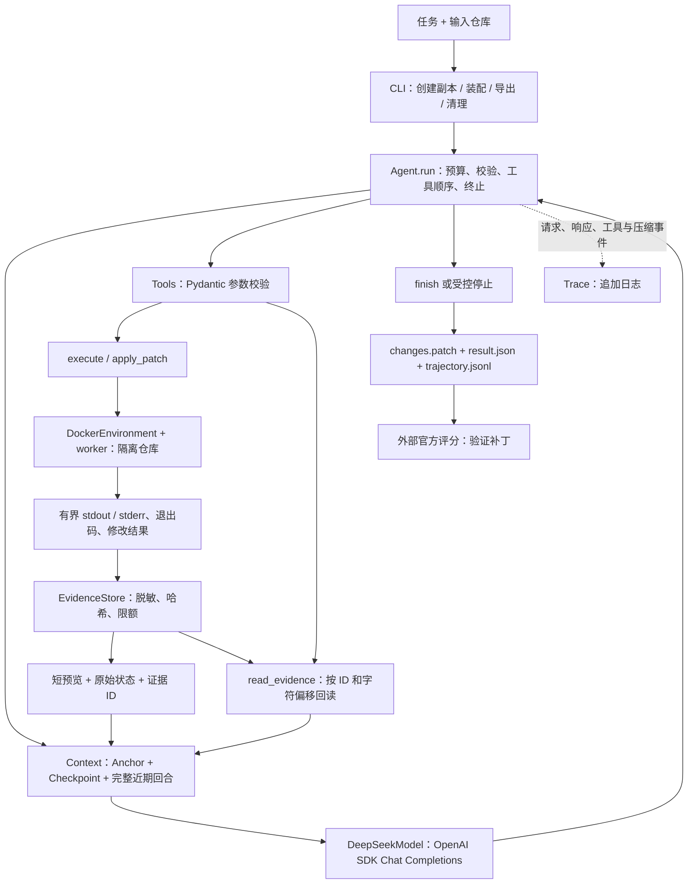
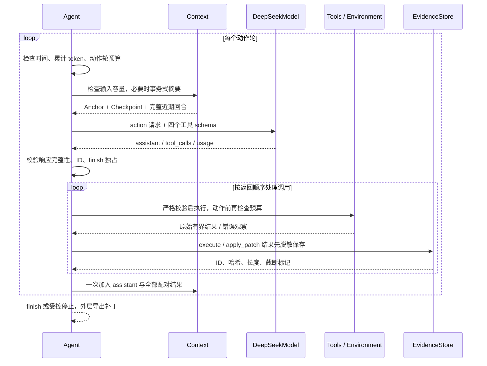
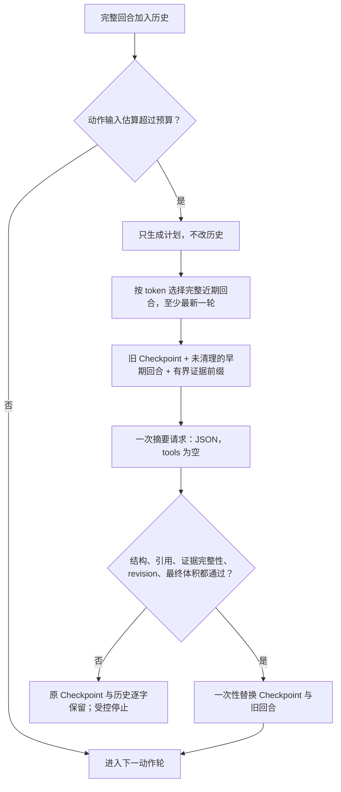

# Coding Harness 项目总报告

> 发布核心：C，`098e27d19042e28f0592dd27dc76ab7859bb19ff`。本文说明本分支实际提供的 Agent 核心；发布整理增加的入口、文档和结果展示不等于重新运行评测。D 的有界工具事实改造是独立实验，**没有并入本次默认核心**。成绩口径及可公开逐题数据以 [评测结果](evaluation-results.md) 和 [results/](../results/) 为准。

## 1. 目标与交付边界

项目实现一个独立的最小 coding agent：接收仓库和修改任务，读取项目规则，自主调用工具检查代码、应用补丁和运行测试，最后导出可复查的差异。课程作业用于理解循环、工具、上下文与评测的分层；本项目不是课程作业的复制品。

“From scratch”限定在控制逻辑：`Agent` 循环、上下文压缩、工具调度和结果记录由本项目实现；HTTP SDK、参数校验、补丁文本匹配和容器由已有库提供。没有调用现成 Agent Runner，也没有自行实现模型、容器引擎或 tokenizer。

默认只保留四个模型工具：`execute`、`apply_patch`、`read_evidence`、`finish`。不实现 Skills、MCP、跨任务长期记忆、多 Agent、逐次撤销或 Agent 会话恢复。兼容目标限于根目录 `AGENTS.md`、Codex 风格补丁外壳和 Git diff 交付，**不是完整 Codex 协议或产品功能兼容**。

## 2. 总体架构：核心循环位于中间

模型负责选择下一步；Agent 决定这一步是否符合协议和预算；执行环境负责实际副作用。评测器只接收候选补丁，不参与 Agent 的下一步决策，也不把隐藏测试或参考补丁交给模型。

### 组件职责与公开契约

| 组件与代码 | 核心接口 | 负责什么、不会做什么 |
|---|---|---|
| [agent.py](../src/coding_harness/agent.py) | `Agent(model, environment, settings, trace).run(task, instructions='') -> dict` | 单次运行的控制循环；不直接实现文件系统或模型传输 |
| [provider.py](../src/coding_harness/provider.py) | `complete(messages, tools, *, timeout, max_output_tokens, purpose) -> Reply` | SDK 请求、原始消息字段和用量适配；不调度工具 |
| [context.py](../src/coding_harness/context.py) | `add_turn`、`messages`、`plan_compaction`、`apply_compaction` | 完整回合管理、结构化摘要、引用与容量验证；不执行工具 |
| [tools.py](../src/coding_harness/tools.py) | `dispatch(environment, name, args_json, timeout, *, evidence=None) -> dict` | 工具 JSON Schema、严格参数校验、错误观察；`finish` 由 Agent 处理 |
| [environment.py](../src/coding_harness/environment.py) | `execute`、`apply_patch`、`collect_patch`、`close` | Docker/Local/Modal 的执行与生命周期；不接收模型密钥、不判断修复正确性 |
| [worker.py](../src/coding_harness/worker.py) | `run_command` 与 stdin JSON RPC | 新 shell、进程超时、有界管道捕获；不调用模型 |
| [patching.py](../src/coding_harness/patching.py) | `apply_patch(workspace, patch) -> dict` | 多文件补丁外壳、路径检查、预验证与落盘；文本 hunk 匹配复用库 |
| [workspace.py](../src/coding_harness/workspace.py) | `prepare_workspace`、`collect_patch` | 过滤输入、独立快照和最终 diff；不修改输入仓库 |
| [evidence.py](../src/coding_harness/evidence.py) | `store`、`contains`、`read` | 本次运行结果保存与完整性校验；不是长期记忆或恢复接口 |
| [trace.py](../src/coding_harness/trace.py) | `event`、`write_json`、`clean` | 追加脱敏事件和结果；不对正确性作判定 |
| [config.py](../src/coding_harness/config.py) / [contracts.py](../src/coding_harness/contracts.py) | `Settings`、`Reply`、`Usage`、`CommandResult`、Protocols | 显式配置与组件边界；密钥不进入 Settings |
| [cli.py](../src/coding_harness/cli.py) | `main(argv=None) -> int` | 参数、任务与 `.env` 读取、组件装配、异常分层和资源清理 |

实现说明分别见 [模块文档](modules/agent.md) 与 [代码—文档映射](code-map.json)。新增评测入口在核心外部编排，不需要为运行一个任务改变上述接口。

## 3. Agent 每轮实际做什么

关键行为如下。

1. **只接受完整模型响应。** `finish_reason` 不是 `stop` 或 `tool_calls` 时不执行该条响应中的工具，避免执行被输出上限截断的请求。Provider 保留 `role/content/tool_calls/reasoning_content`，并统计模型报告的输入、输出与缓存 token；原始推理字段不被编造成用户可见的解释。
2. **一次回复可以有多个工具，但顺序执行。** 同轮 call ID 必须唯一；跨轮复用 ID 不会误判重复。`Context.add_turn` 要求工具观察的 ID 与调用列表逐项对应，不允许孤立结果或拆开一批调用。
3. **协议错误和命令失败不同。** 坏 JSON、未知工具、参数非法形成 `ok=false` 观察。`execute` 成功运行一个失败测试时可以是 `ok=true, exit_code=1`：这里的 `ok` 表示调度成功，不能解释为测试通过。
4. **写操作没有自动重放。** 工具已经尝试执行、随后证据落盘失败时，Agent 以 `evidence_budget` 停止，记录“动作可能已执行”。这避免为补齐日志重复修改文件。SDK 自身的模型传输重试与工具重放是不同机制。
5. **纯文本回复不会被当作完成。** 没有工具调用时，循环添加“使用工具或 finish”的提醒。`finish` 必须单独出现，且参数恰为一个非空 `summary`；混入其他调用会拒绝该轮整批调用。

### C 的收尾策略

提示要求围绕“复现或检查问题 → 修改 → 验证目标行为 → 运行相关测试 → 检查最终 diff → finish”推进。后续探索应回答具体的未解决问题，不要求全仓测试全部变绿。未运行测试、剩余异常和验证限制需要如实说明，疑似环境问题不能写成已确认原因。

这只是模型行为引导。程序不会因为最近一次测试成功就强制结束，也不会因为存在失败命令就禁止 `finish`；`completed` 表示模型作出完成声明，外部评分仍可能失败。

### 有界重复提醒

C 在最近八次 `execute` 中发现三次**参数字符串与记录结果均相同**时，只发出一次带旧证据 ID 的提醒。成功 `apply_patch` 会清空观察窗口。它不拦截命令、不缓存替代执行，也不证明文件系统没有变化；模型仍可写后重读或再次测试。因为比较的是脱敏后完整记录，语义相同但文字不同的命令不一定触发，反之相同输出也不必然代表重复工作无价值。

## 4. 上下文：四层数据与事务式压缩

### 4.1 模型每次看到的内容

| 层 | C 版本实际保存的内容 | 生命周期 |
|---|---|---|
| Anchor | 系统提示、环境说明、原任务、根 `AGENTS.md` | 原文固定，摘要不能改写 |
| Checkpoint | `model_notes`、`next_steps`、证据 ID，以及程序填回的 `tool_facts` | 每次成功压缩后替换 |
| Recent tail | assistant 原消息与其全部工具观察 | 按预算保留完整回合，至少保留最新一轮 |
| Evidence | 工具名、原参数、call ID 与完整的**有界**执行结果 | 宿主产物目录保存，按随机 ID 回读 |

`Anchor`、`CheckpointDraft`、`CheckpointNote`、`ToolFact` 使用 Pydantic。摘要只允许给出模型笔记、后续计划与已知证据引用；原始退出码、超时、捕获截断、修改文件列表等由程序填充，不接受摘要模型改写。笔记引用合法只证明可追溯，**不证明笔记在语义上正确**。

C 的 schema 上限为 20 条笔记、12 条下一步、每条文本 1600 字符；摘要提示另要求尽量不超过六条短笔记、三条短下一步。提示目标和 schema 硬上限不是同一个概念。

### 4.2 超预算后的顺序

`plan_compaction()` 使用尚未清理的早期回合，保留这些回合当时实际可见的预览。它还补充最多 8000 字符证据前缀，每条最多 2000 字符，优先较新的旧证据；这不是完整日志检索，前缀可能主要是命令参数。

`apply_compaction()` 验证摘要正常结束、角色和 JSON/schema 正确、没有工具调用、引用来自计划、证据仍存在且完整、计划 revision 未过期。再组装完整候选输入，要求它不超预算，且相对旧历史节省超过 32 个估算 token，才一次性替换。错误、伪造引用、摘要过长或容量不足不会先把历史删掉。摘要失败不自动重试，也不会重放先前工具动作。

这修正了早期版本“先删除旧预览，只要重新落回预算就继续，可能尚未形成工作状态”的顺序。当前 C 没有这一提前清理路径。

### 4.3 预算是估算与操作边界，不是精确账单承诺

`estimate_tokens()` 对包含 messages 和工具 schema 的 JSON 进行 UTF-8 编码，使用约 `ceil(bytes / 2)` 加消息/工具开销的启发式估算。它不是 DeepSeek tokenizer，也不保证所有输入形式下都高估。

动作输入上限为 `min(context_tokens, model_context_tokens - 本次输出预留 - margin)`；摘要允许使用剩余配置窗口，但也通过同一发送前检查。默认模型窗口 128000 是本项目配置，不是通过 API 自动探测到的模型规格。

`Usage.total_tokens` 累加每次实际回复的输入与输出，包含摘要以及缓存命中的输入。当前实现会在请求前检查已用量并限制输出，但没有为下一次输入预留全部累计额度；请求返回后才得到真实用量，因此累计 token 阈值可能被最后一次请求越过。SDK 最多两次传输重试、清理耗时等也使操作时间预算不等于外部强制抢占的精确墙钟上限。

### 4.4 C 的已知容量缺陷与 D 的边界

**C 仍会累加所有已经进入 Checkpoint 的工具事实和证据 ID。** `plan_compaction()` 合并旧 `evidence_ids` 与新压缩回合的 ID；`apply_compaction()` 把这些事实全部重新放入 Checkpoint。即使模型笔记足够短，事实元数据与近期回合也可能耗尽 24000 的动作输入预算。

所以“原始输出已外置”不等于“模型输入已永久有界”。长任务可以在剩余动作轮和累计 token 仍充足时，以 `compaction_failed` 或 `context_budget` 结束。增加 300 轮/500 万 token 预算不能解决这一结构问题。摘要请求本身过大也会在发送前受控拒绝。

独立 D 实验 `2f77d31c8107f2b440d0ac64a9638dfbb0702234` 尝试把旧工具事实也移到分页历史索引，只保留有界活跃状态和失败记录，并对近期大结果作事务式投影。**这些能力不在本次 C 发布核心中**。D 的三题实验也没有显示更好成绩，其中一题因摘要 schema 不满足要求而停止；它不能被描述为已经证明更强的默认版本。实验结果见 [版本对比](evaluation-results.md)。

## 5. 工具、补丁与证据的具体实现

### `execute`：一个通用 shell 工具

读文件、搜索和运行测试均通过新 shell 执行。文件修改会持续保留；`cd` 或临时环境变量不跨调用继承。worker 并行读取 stdout/stderr，默认每流捕获 1 MiB，超限后继续排空管道但只保留前缀，并设置 `truncated=true`。超时尝试终止进程树；Docker RPC 控制端超时会关闭本实例容器，不能把 docker exec 客户端退出误当作命令已停止。

工具提示建议代码编辑使用 `apply_patch`，但 shell 仍有写能力；专用补丁工具不是安全边界，隔离由 Environment 提供。

### `apply_patch`：明确而可检查的编辑

接受 `*** Begin Patch` / `*** End Patch` 及新增、更新、删除、移动文件指令。文本 hunk 应用调用 `openai-agents` 的公开 `agents.apply_diff`；本项目实现外壳解析、路径约束和落盘，没有复制 SDK parser，也不使用该 SDK 的 Runner。

补丁先计算全部文件的修改，再开始写入，避免第二个文件匹配失败后第一个文件已经变动。拒绝绝对路径、`..`、`.git`、链接/reparse 路径、重复目标及覆盖已有移动目标。当前限制为补丁 256 KiB、100 个操作、单文件 5 MiB，仅支持 UTF-8 文本。

逐文件临时文件替换与 I/O 失败恢复不等于多文件崩溃事务，也不提供用户撤销。最终交付的 `changes.patch` 是 Git diff，和模型逐次调用的补丁格式不同。

### `read_evidence`：回查已经看到的结果

Agent 对 `execute/apply_patch` 先记录原始有界 `tool_result`，再将脱敏记录存入 EvidenceStore，最后生成默认最多 12000 字符的模型预览。模型观察同时携带原始事实、证据 ID、哈希与预览截断标记。

证据 ID 不含宿主路径。`read(id, start, limit)` 按字符分页，验证本次登记、长度、SHA-256 和非链接文件；`limit` 最多 16000。读取证据本身不再入库，避免递归保存。`next_start=null` 只说明存储内容已读完，不能说明执行捕获没有丢失末尾。

默认 Agent 证据额度为每条 16 MiB、总计 64 MiB。C 的 `store` 单条超额会先保存截断前缀，Agent 随后发现 `truncated` 并停止；不能把它描述成 D 的“结构化记录超额时完全不写入”。SHA-256 校验用于发现外部损坏，不是针对恶意宿主的权限隔离。

## 6. 工作区与执行环境

普通 `run` 对输入建立经过过滤的独立快照，在新输出目录里初始化内部 Git 基线。排除常见凭证、缓存、虚拟环境、产物和链接；输入仓库不改动。源目录不是独立 Git 顶层时，不会擅自沿用祖先仓库的忽略规则。当前不支持完全空的输入项目。

默认 Docker 运行副本，上传文件而不挂载宿主仓库、home、Docker socket 或密钥；默认禁网、限制 CPU/内存/PID。构建镜像下载依赖需要网络，与任务容器运行时禁网不同。容器有随机所有权标记，清理仅针对自己创建的资源。Local 必须显式 `--allow-local`，它只提供目录副本，不具备操作系统级隔离。Modal 是可选后端，不能用替身测试替代真实云端验证。

SWE-bench 使用专门适配：镜像 HEAD 可能是数据集 base_commit 的一个 `SWE-bench` 安装提交。`BenchmarkDocker` 验证这一父子关系、记录安装改动并保留官方环境，以实际安装 HEAD 为补丁基线；不会直接 reset 掉安装步骤。通用 DockerEnvironment 的严格基线检查仍保留。

Trace 使用已知 secret 字符串替换做脱敏，不是通用秘密识别器。输入过滤同样是防误传措施，不应据此宣称能安全执行任意恶意仓库或在任意环境中发现所有凭证。

## 7. 默认值与正式实验配置不能混为一谈

| 设置 | C 的 Settings 默认值 | 本次 C30 固定设置 |
|---|---:|---:|
| 动作轮上限 | 30 | 300 |
| 累计输入 + 输出 token | 100000 | 5000000 |
| Agent 时间预算 | 900 秒 | 900 秒 |
| 单次动作最大输出 | 8192 token | 32768 token |
| 请求超时 | 90 秒 | 180 秒 |
| 动作输入软预算 | 24000 | 24000 |
| 模型配置窗口 | 128000 | 128000 |
| 输出外余量 | 1024 | 1024 |
| 近期回合预算 / 回合数上限 | 6000 / 2 | 6000 / 2 |
| 摘要最大输出 | 2048 token | 2048 token |
| 模型 / 动作推理档 | `deepseek-flash` / `high` | 相同 |

摘要调用使用 `reasoning_effort=none`，省略空 tools 参数。最大动作轮数不是工具调用次数；摘要请求也消耗 token 和时间，但不增加动作轮计数。

安装、凭证配置与实际入口以 [README](../README.md)、[本地运行说明](local-setup.md) 和新增入口文档为准。普通小任务不必直接采用 C30 的较高预算。

## 8. 评测结果及可以得出的结论

### 同一固定前 30 题

| 系统 | 官方完整解决数 / 固定分母 | 解决率 | 模型请求 | 累计 token |
|---|---:|---:|---:|---:|
| 裸 DeepSeek：确定性检索、一次生成补丁 | 9 / 30 | 30.0% | 30 | 1,136,926 |
| C Harness：工具循环、证据回读、事务式摘要、收尾提示 | 20 / 30 | 66.7% | 1,101 | 12,492,812 |

这次子集上的差值为 11 题、约 36.7 个百分点。C30 中 24 题进入评分、6 题没有补丁，未知结果为 0；不能只用有补丁的 24 题作分母。1,101次请求包含897次动作与204次摘要。

C30 的19题以 finish 结束，11题以 compaction_failed 结束；后者5题仍有补丁并接受评分，6题为空补丁。这个停止标签本身不区分摘要格式、引用或容量等拒绝原因，不能把全部11题都直接解释为工具事实累积。

这些是固定数据集先按 instance_id 升序排序后选出的前30题（6题 Astropy、24题 Django），不是 Parquet 的天然行序，不是 SWE-bench Lite 全部300题，也不是随机抽样或官方排行榜成绩。C30 复用已完成且版本、配置、任务和补丁绑定均一致的原前三题，只新生成后 27 题；不是反复补考后挑最好结果。

“裸模型”也有宿主端确定性检索：按题面在 pinned base 的源码中选取最多 64000 字符，单次生成 Git diff；没有工具调用和测试反馈。Agent 可以多轮探索并消费更多 token。因此结果支持“这套有工具的运行方式在此子集比该单次基线解决更多问题”，不能把全部差异归因于上下文压缩或某条提示。

### 原前三题的版本诊断

| 版本 | 主要变化 | 官方解决数 |
|---|---|---:|
| A | 原先的上下文交接与结束提示 | 2 / 3 |
| B | 事务式摘要、工作状态提示、有界重复证据提醒 | 1 / 3 |
| C | B 加聚焦任务的收尾提示 | 2 / 3 |
| D | 工具事实也外置、有界状态与历史索引 | 1 / 3 |
| mini-SWE-agent 2.4.6 | 原生 SWE 配置与循环，接相同 DeepSeek | 2 / 3 |

A/B/C/D 的对应诊断固定 300 动作轮、500 万累计 token 与 900 秒配置。mini 保留原生 SWE 配置 250 步、估算 3 美元上限，另加宿主 900 秒保护；没有强行套用我们的累计 token 限额。模型名、动作推理档、单次输出与请求超时对齐，但预算策略和提交方式仍不同。

开发期间已经反复查看这些案例，属于开发评测，不是未接触过的保留测试集；C3 已计入 C30，两者不独立。模型名也是当时服务端别名，并未锁定不可变权重。三题样本不足以证明 C 优于 mini、D 优于 C，或把一次涨跌归因为单个组件。B 本身也同时改变了摘要输入、提示与重复提醒，不是严格单变量实验。详细停止原因、耗时、用量和每题判定见 [完整结果](evaluation-results.md)、[first30.json](../results/first30.json)、[first3.json](../results/first3.json)。

## 9. 评测与验收如何避免自报成功

任务入口只向模型提供题面及允许的仓库内容；grader 专用数据在独立目录，参考补丁和隐藏验收信息不进入模型输入。官方验证器固定为 `swebench==4.1.0`，用独立环境应用实际导出的补丁并运行测试。

记录至少区分：生成了候选补丁、模型调用 finish、官方修复成功、补丁应用拒绝、空补丁和基础设施未判明错误。模型预算耗尽时若已有非空补丁，仍可以交官方验证；`finish` 的有无不是通过判据。官方缺少 report 时也不能直接算通过，需按补丁哈希与明确日志证据分类。

发布结果提供逐题状态、预算、版本与来源哈希，不包含密钥、宿主路径、完整模型轨迹、参考补丁或隐藏测试正文。`results/SHA256SUMS` 可检测公开文件是否变化；原始 trace/patch/grader 日志仍是本地证据，未随源码重新分发。

批次续接是外层调度按账本复用终态任务，与恢复 Agent 内部会话不同。已开始但状态不明的任务不能悄悄从头再调用模型。C30 运行过程中采用的并发、私有镜像标签和预热属于基础设施，不能写成核心 Agent 的多任务推理能力；源码相同也不保证 API 和测试时序完全确定。

## 10. 验证体系与代码文档同步

| 验证层 | 证明的内容 | 不证明的内容 |
|---|---|---|
| Provider / Agent 离线替身测试 | 消息保留、错误分类、预算边界、工具顺序、不重放 | 模型是否真正理解任务 |
| Context / Evidence 回归 | Anchor 不漂移、配对、非法引用拒绝、失败不覆盖历史、证据完整性 | 摘要语义一定正确、任意长任务一定可继续 |
| Patch / Workspace / Worker 测试 | 路径约束、多文件预验证、源目录不改、截断与超时处理 | 任意恶意环境下的完整安全性 |
| 真实 API / Docker 冒烟 | 实际请求和实际工具闭环能接通 | SWE-bench 完整能力分数 |
| 官方逐题验收 | 指定补丁在指定版本测试上的判定 | 其他任务或未来模型版本的成功保证 |

对应说明：[核心测试](testing-core.md)、[证据测试](testing-evidence.md)、[执行测试](testing-execution.md)、[CLI 测试](testing-cli.md)。发布整理的实际测试结果由本次验证记录报告，不把另一开发分支的测试数量贴到 C 版。

`AGENTS.md` 要求每次代码、测试、脚本、依赖或配置修改同步对应文档。`scripts/check_docs_sync.py` 依据精确映射检查缺失说明和代码—文档净差异；它能拒绝空白更新，但不能代替人工判断文档语义。仓库 hook 与 CI 分别检查暂存内容和提交范围。

## 11. 为什么保留这些组件

| 选择 | 理由 | 付出的代价 |
|---|---|---|
| 自写循环，复用 SDK | 协议和预算可解释，可注入替身验证 | 要自己处理状态与失败边界 |
| 专用补丁工具 | 编辑目标清楚，能在落盘前验证整份补丁 | SDK 依赖与运行时环境更重 |
| 原文 Anchor + 结构化摘要 | 避免目标漂移，保留工作状态 | 摘要本身会失败，C 仍有事实累积容量问题 |
| Evidence 外置与分页回读 | 长输出不必每轮全部塞回模型 | 模型必须主动找回细节；存储和截断有上限 |
| Docker 默认、Local 显式允许 | 与宿主环境隔离，测试环境可记录 | 冷镜像安装、存储和资源调度成本明显 |
| 评测放在 Agent 外部 | 任务解决逻辑不掺入隐藏判分信息 | 需要维护版本、补丁和报告绑定 |

后续优先级应由失败记录决定：在独立冻结版本中完善 D 的有界事实压缩、摘要格式失败诊断与长轨迹回归，再进行同题同预算复评；不因为组件列表更长就加入长期记忆、MCP 或多 Agent。

## 12. 来源与许可边界

课程提供概念参考；mini-SWE-agent 是独立对照实现；OpenAI SDK 和 `openai-agents` 是具体依赖。项目名中的 harness 不表示官方 Codex 或 DeepSeek 项目背书。

依赖、参考实现和数据来源见 [第三方说明](../THIRD_PARTY_NOTICES.md)。本次公开展示源码，不替项目所有者新增 MIT 等项目级授权，也不以某个依赖的许可替代本项目许可。
